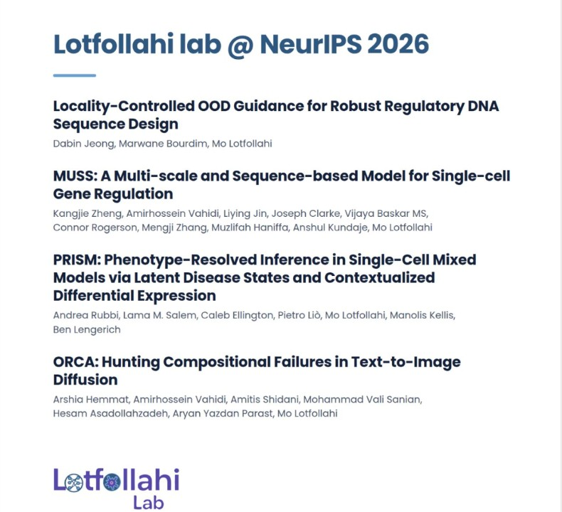

Excited to share that our lab will be at **#NeurIPS2026** with **4 papers**! Huge congratulations to everyone in the lab, and thank you to our wonderful collaborators, including [Muzlifah Haniffa](https://haniffalab.com/), [Anshul Kundaje](https://kundajelab.stanford.edu/), [Manolis Kellis](http://compbio.mit.edu/), [Ben Lengerich](https://benlengerich.github.io/), and [Pietro Liò](https://www.cl.cam.ac.uk/~pl219/).

<!-- truncate -->

### Locality-Controlled OOD Guidance for Robust Regulatory DNA Sequence Design

**Dabin Jeong, Marwane Bourdim, Mo Lotfollahi**

---

### MUSS: A Multi-scale and Sequence-based Model for Single-cell Gene Regulation

**Kangjie Zheng, Amirhossein Vahidi, Liying Jin, Joseph Clarke, Vijaya Baskar MS, Connor Rogerson, Mengji Zhang, Muzlifah Haniffa, Anshul Kundaje, Mo Lotfollahi**

---

### PRISM: Phenotype-Resolved Inference in Single-Cell Mixed Models via Latent Disease States and Contextualized Differential Expression

**Andrea Rubbi, Lama M. Salem, Caleb Ellington, Pietro Liò, Mo Lotfollahi, Manolis Kellis, Ben Lengerich**

---

### ORCA: Hunting Compositional Failures in Text-to-Image Diffusion

**Arshia Hemmat, Amirhossein Vahidi, Amitis Shidani, Mohammad Vali Sanian, Hesam Asadollahzadeh, Aryan Yazdan Parast, Mo Lotfollahi**

---

See you in Sydney! 🇦🇺
